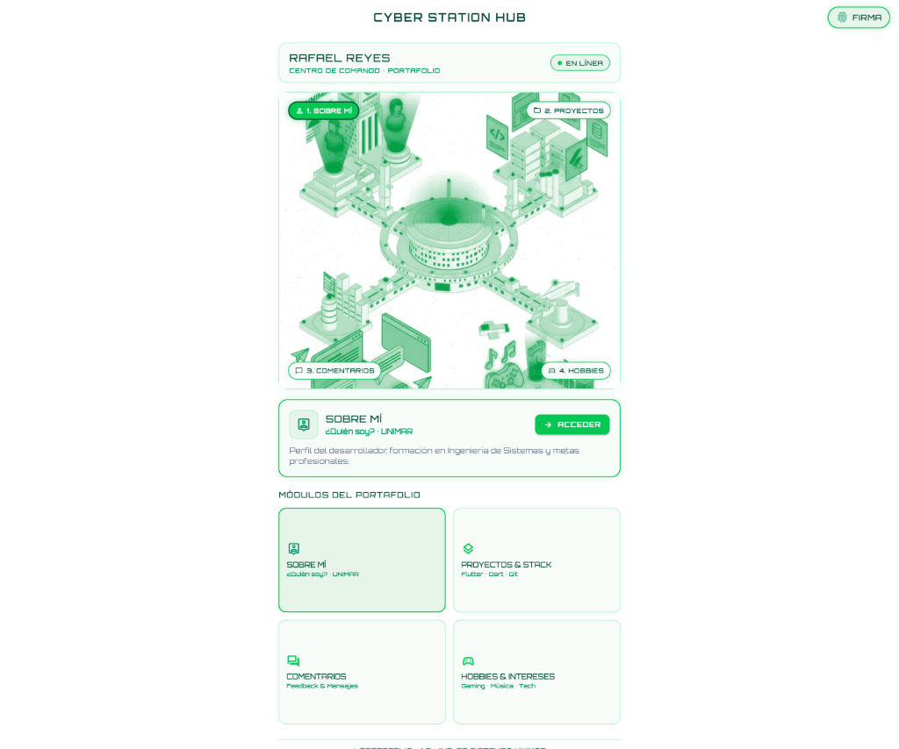

# Portafolio Personal Cyber Station - Programación III

Aplicación móvil y web interactiva tipo Portafolio desarrollada en Flutter y Dart para el Proyecto (20%) de la Unidad 3 de Programación III en la Universidad de Margarita (UNIMAR).

El diseño está inspirado en una estación espacial ciberpunk isométrica central con cuatro cuadrantes de navegación interactivos, modo limpio personalizado y paleta verde esmeralda y blanco.

<p align="center">
  
</p>

---

## Características y Secciones

- **Estación Central Interactiva (Home):** Panel principal con imagen temática isométrica y cuatro nodos interactivos que se iluminan al ser seleccionados.
- **Sobre Mí / ¿Quién soy?:** Perfil personal, datos académicos en UNIMAR, carrera y enfoque técnico.
- **Proyectos & Stack:** Lista de proyectos desarrollados (incluyendo la Calculadora Móvil de Prog III) y chips con las tecnologías dominadas (Flutter, Dart, Git, VS Code, POO).
- **Hobbies & Intereses:** Sección de pasatiempos que complementan el desarrollo (Gaming, música Synthwave, tecnología y café).
- **Módulo de Comentarios:** Formulario interactivo con validación de campos para escribir y publicar mensajes en memoria en tiempo real.
- **Firma del Desarrollador (AppBar):** Botón dedicado en el AppBar que navega a una vista exclusiva con la firma digital de autoría y canales de contacto directo.
- **Pie de página (Footer):** Información de copyright, autoría y versión en la vista principal.

---

## Estructura del Proyecto

El código aplica buenas prácticas de programación, nomenclatura `lower_snake_case` para archivos y `UpperCamelCase` para clases, con un `main.dart` limpio y arquitectura modular:

```text
lib/
├── models/
│   ├── comment_model.dart       # Modelo para la gestión de comentarios
│   └── project_model.dart       # Modelo para el catálogo de proyectos
├── routes/
│   └── app_routes.dart          # Definición centralizada de rutas nombradas
├── screens/
│   ├── home_screen.dart         # Centro de comando interactivo con la estación
│   ├── about_screen.dart        # Vista Sobre Mí / ¿Quién soy?
│   ├── projects_screen.dart     # Vista de Proyectos y Stack tecnológico
│   ├── hobbies_screen.dart      # Vista de Hobbies e Intereses
│   ├── comments_screen.dart     # Vista interactiva de comentarios y feedback
│   └── signature_screen.dart    # Vista de Firma del Desarrollador y Contacto
├── theme/
│   └── app_theme.dart           # Configuración del tema oscuro neón y fuentes
├── widgets/
│   ├── custom_app_bar.dart      # AppBar con acceso rápido a la firma digital
│   ├── footer_widget.dart       # Pie de página adaptable
│   └── station_node_button.dart # Botones de nodo interactivo con animación
└── main.dart                    # Punto de entrada limpio con rutas y tema
```

---

## Dependencias y Recursos

- **Flutter SDK:** `>=3.13.7 <4.0.0`
- **google_fonts:** Para tipografía temática (`Orbitron`, `Rajdhani`, `Dancing Script`).
- **cupertino_icons:** Íconos auxiliares.
- **Assets locales:** Gráfico temático de la estación espacial en `assets/images/station_bg.jpg`.

---

## Cómo Ejecutar la Aplicación

1. Clonar el repositorio:
   ```bash
   git clone https://github.com/RAFAELREYESDEV/portafolio.git
   ```
2. Entrar a la carpeta del proyecto:
   ```bash
   cd portafolio
   ```
3. Obtener las dependencias:
   ```bash
   flutter pub get
   ```
4. Ejecutar en Chrome (Web):
   ```bash
   flutter run -d chrome
   ```
   *O ejecutar en un emulador Android o dispositivo móvil conectado.*

---

## Datos del Estudiante

- **Nombre y Apellido:** Rafael Reyes
- **Usuario GitHub:** [@Rafaelreyesdev](https://github.com/RAFAELREYESDEV)
- **Carrera:** Ingeniería de Sistemas
- **Decanato:** Decanato de Ingeniería y Afines
- **Universidad:** Universidad de Margarita (UNIMAR)
- **Materia:** Programación III (V-01)
